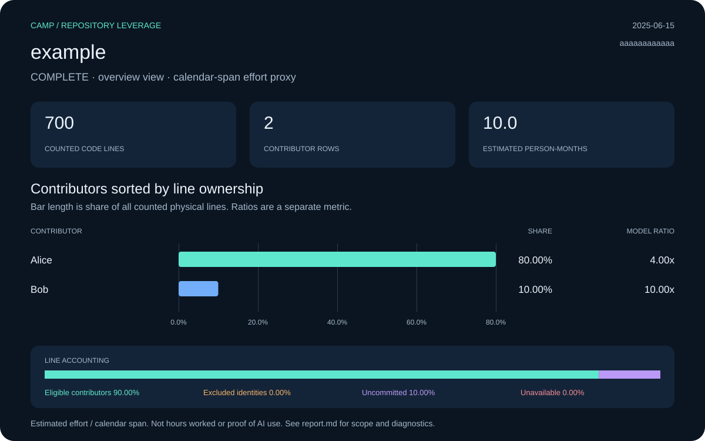

# leverage

An installable agent skill for Camp leverage reports, contributor tables and exact SVG charts. Point it at a local Git repository; no camp workspace or Festival plan is needed.

**Private preview.** This repository currently requires authorized GitHub access. The skill works with agent clients that load a standard `SKILL.md` directory. It bootstraps Festival when needed, then uses Camp's structured report output. Scoring stays in Camp; this package collects and presents its results.



[Inspect the synthetic example](examples/README.md).

[Browse real repository reports](reports/README.md): dated measurements of T3 Code, Crush, Codex, Gemini CLI and Aider, with charts, full contributor CSVs and source provenance.

## Install the skill

Ask Codex's skill installer to install `skills/leverage` from this repository:

```text
Install the leverage skill from https://github.com/Obedience-Corp/leverage/tree/main/skills/leverage
```

Alternatively clone the private repository and copy the self-contained directory into your client's skill location. For a user-level Codex install:

```sh
git clone git@github.com:Obedience-Corp/leverage.git
mkdir -p ~/.codex/skills
test ! -e ~/.codex/skills/leverage
cp -R leverage/skills/leverage ~/.codex/skills/leverage
```

For Claude Code's user-level skills, use `~/.claude/skills/leverage` as the destination. Keep an existing installation rather than copying over it blindly; update from a reviewed revision. An authorized GitHub skill installer can also pin a tag/commit. The skill directory contains all runtime resources; the source checkout is unnecessary after installation. Restart/reload the client's skill discovery if required.

## Use it

Ask your agent:

> Use leverage on this repo and generate a visual contributor report.

> Use leverage to calculate the personal view for alice@example.com.

> Render my saved Camp JSON reports with the light theme.

The default bundle includes Markdown, the full contributor CSV, portable snapshot metadata, SVG and original raw captures. PNG is optional. Bars show physical-line ownership; ratio values remain a separate metric.

| Request | Mode | What it collects |
| :--- | :--- | :--- |
| Repository score and contributor chart | `overview` (default) | Summary and all attributable contributor rows |
| Repository score only | `summary` | Summary; no contributor rows |
| One author's score | `personal --author EMAIL` | Selected score and matched-identity count; no contributor rows |

Personal and summary images show the selected ratio and effort proxy. Source counts, estimated repository effort and line accounting still describe the whole repository; their CSV is header-only. Personal selectors can match several identities, so inspect the matched count before comparing with one contributor row. Contributor rows represent surviving line owners, not everyone who ever committed.

You can call the scripts directly:

```sh
python3 skills/leverage/scripts/collect.py /path/to/repo --png
python3 skills/leverage/scripts/collect.py /path/to/repo --mode personal --author alice@example.com
python3 skills/leverage/scripts/collect.py /path/to/repo --mode summary --people 2
python3 skills/leverage/scripts/render.py \
  --repository /path/to/summary.json --contributors /path/to/contributors.json \
  --output /path/to/new-report --theme light --sort ratio --png
```

The default destination is a new sibling directory of the analyzed Git root. Use `--output` to choose another new directory outside that root. No source edits, camp creation, repository linking, commits or uploads occur. Use saved JSON to change styling without rescanning. Exit 2 means a partial report was written; inspect its diagnostics.

After a default run, the saved inputs are `<report>/raw/repository.json` and `<report>/raw/contributors.json`. Pass those to `render.py` for another theme or sort order; it does not invoke Camp, Git, scc or the installer. Omit `--png` to render without any external commands. The table shows up to `--top` rows (10 by default), the SVG shows up to eight, and the CSV retains every collected row. Sorting by ratio keeps bar lengths tied to physical-line share.

To rerender a personal report, use `--personal <report>/raw/personal.json`. For a summary-only report, use `--repository <report>/raw/repository.json` without `--contributors`. Use inputs from the same snapshot when combining files.

## Dependencies and bootstrap

Python 3.11+, Git and scc are required. Festival supplies Camp/Fest/the Festival manager; the skill's helper verifies official release checksums and installs missing components into a user directory. Compatible installations are reused, custom binaries are preserved, and package/manager ownership determines updates. It reports each install/update and returns the verified Camp executable path. No global shell-profile changes are made.

```sh
bash skills/leverage/scripts/ensure-festival.sh --check
```

Check mode makes no network requests or writes. macOS/Linux automatic bootstrap is supported; WSL2 is the Windows path for this version. Native Windows runtime support is not claimed. See [installation details](skills/leverage/references/installation.md). `--camp /absolute/path` lets an already-provisioned environment skip bootstrap after capability verification.

`rsvg-convert` is optional for PNG. No image-generation API or paid service is required. See [measurement](skills/leverage/references/measurement.md) and [data contracts](skills/leverage/references/output-contracts.md) for the model, null/partial behavior and exported identity policy.

## Development

```sh
just test all   # deterministic install/render tests in a disposable container
just test live  # actual verified Festival install and outside-camp Git workflow
```

Tests copy the installable directory and run as an unprivileged container user. Filesystem mutation/install tests refuse the host lane. Runtime scripts use Python's standard library; PyYAML is a test-only dependency for validating metadata. The Docker test image includes scc and a rasterizer. `examples/` uses synthetic data; `reports/` contains real measured snapshots with portable contributor data and explicit provenance. Neither belongs to the installable skill directory. Run `just reports check` to verify report hashes, CSV values, accounting and portable metadata.

Nothing is published by invoking the skill. Raw JSON includes original identities/local paths; portable data omits them while retaining display names and exact metrics.
