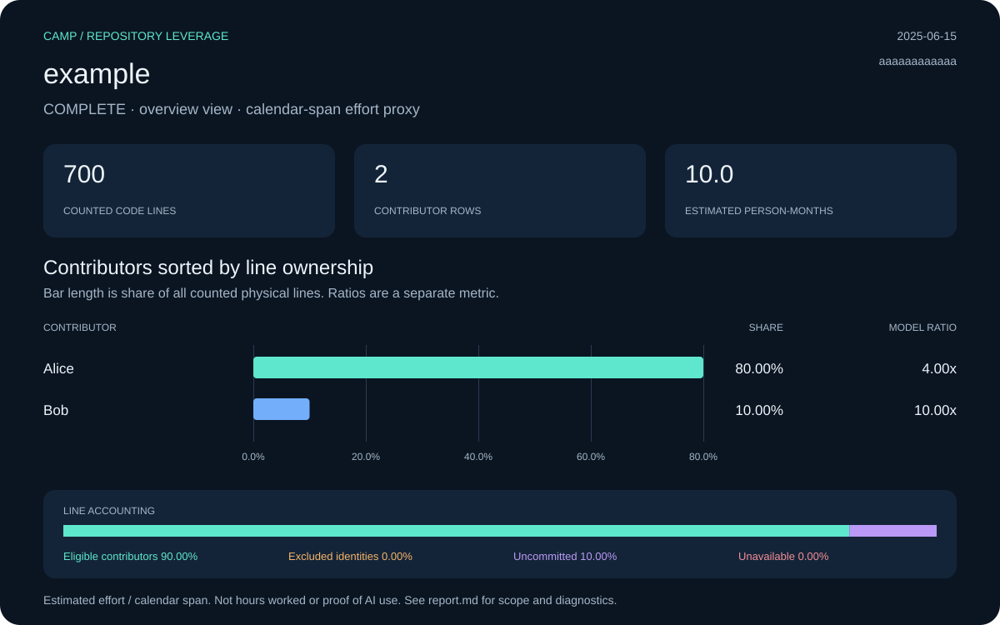

# example: Camp leverage report

**Status:** complete · **Snapshot:** 2025-06-15T12:00:00Z · **Revision:** `aaaaaaaaaaaaaaaaaaaaaaaaaaaaaaaaaaaaaaaa`

| Measurement | Result |
| :--- | ---: |
| Files | 2 |
| Code lines | 700 |
| Physical lines | 1,000 |
| Estimated effort (PM) | 10.00 |
| Repository ratio | 4.00x |
| Effort basis | fixture |

## Contributors

Sort: ownership. Showing up to 10 of 2 collected rows.

| Contributor | Physical lines | Share | Est. PM | Span PM | Ratio |
| :--- | ---: | ---: | ---: | ---: | ---: |
| Alice | 800 | 80.00% | 8.00 | 2.00 | 4.00x |
| Bob | 100 | 10.00% | 1.00 | 0.10 | 10.00x |

[Contributor CSV](data/contributors.csv) · [Snapshot metadata](data/snapshot.json)

## Line accounting

| Bucket | Physical lines | Share | Estimated PM |
| :--- | ---: | ---: | ---: |
| Eligible contributors | 900 | 90.00% | 9.00 |
| Excluded identities | 0 | 0.00% | 0.00 |
| Uncommitted | 100 | 10.00% | 1.00 |
| Unavailable | 0 | 0.00% | 0.00 |

## Method and diagnostics

PM means person-months. COCOMO effort is allocated by surviving physical-line ownership. Contributor ratios divide that allocation by repository-wide local-ref commit spans, floored at 0.1 months. Exclusions limit current source ownership, not the historical span. Repository summary and manual team-size views have their own recorded effort basis; contributor ratios must not be added.

Calendar span is not a timesheet. A result covers one repository, not a person’s total work or proof of AI use. Uncommitted, excluded and unavailable shares are kept separate. Null ratios are unavailable, not zero.

Diagnostic codes: none.

Raw exports, when present under `raw/`, include original identities and local paths. Portable data omits email IDs and local paths; display names are retained. Nothing was published.
