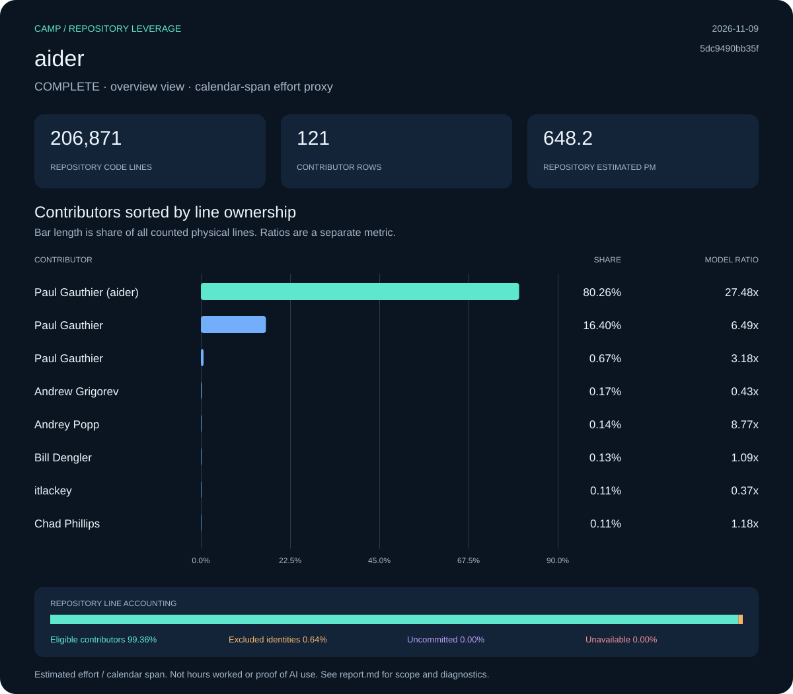
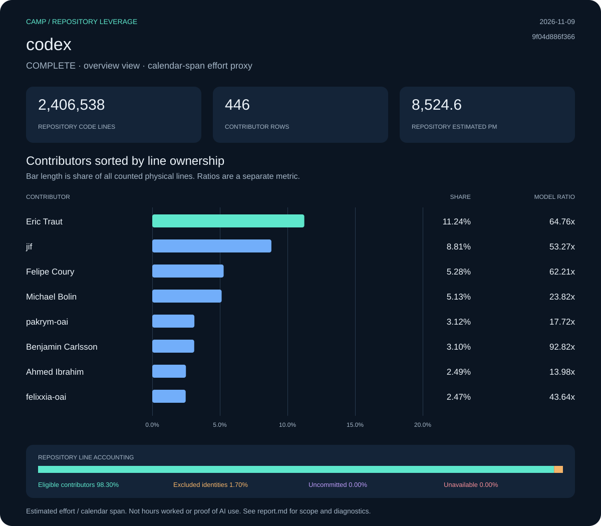
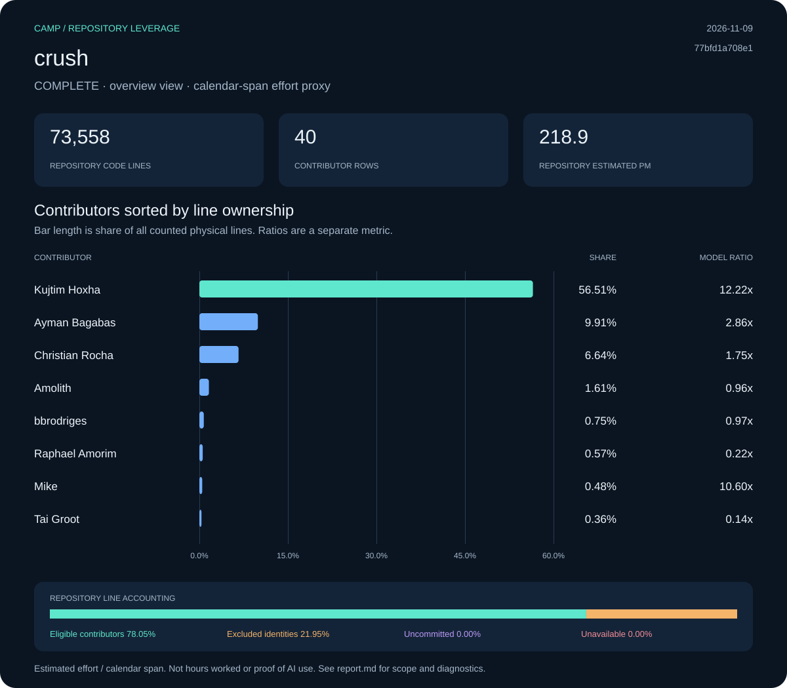
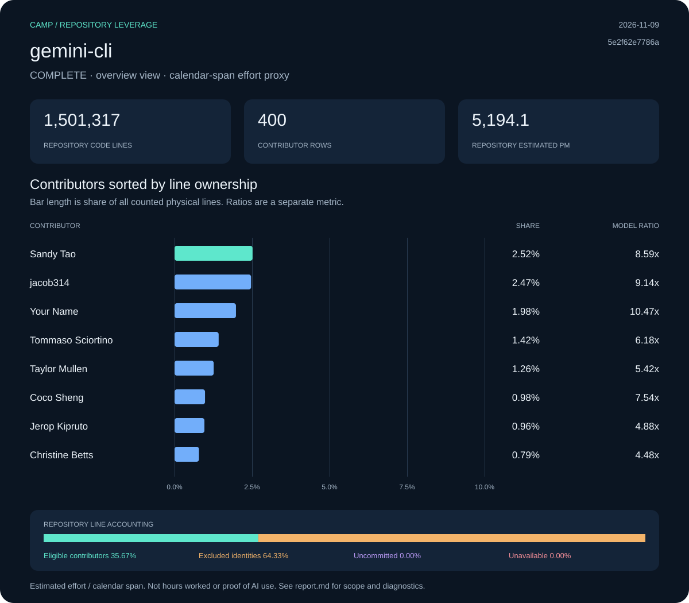
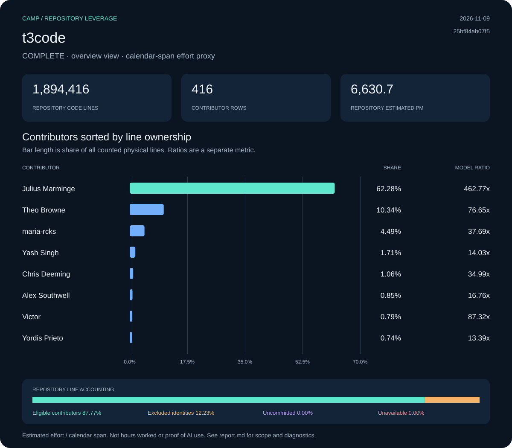

# Real repository reports

Measured snapshots from public AI development repositories. Open a report to inspect its contributor table, line accounting, method and diagnostics; download the CSV for every collected row. Display names are retained, while email identities and local machine paths stay out of the archive.

All measurements below were generated on **November 9, 2026 UTC**. The source commits have different dates. T3 Code and Crush preserve the snapshots used in the earlier skill trials; Codex, Gemini CLI and Aider were collected from separately refreshed, full-history checkouts. A source commit date describes the measured code, not the age of the report.

These are examples of the same calculation under recorded inputs. Repository sizes, history, imported/generated material and ignore rules differ; the table is alphabetical and is not an engineering ranking or proof of AI effectiveness. No independent audit of AI use or remaining generated code was performed.

| Repository | Source commit date | Code lines | Contributor identities | Repository ratio | Report |
| :--- | :--- | ---: | ---: | ---: | :--- |
| [Aider-AI/aider](https://github.com/Aider-AI/aider/tree/5dc9490bb35f9729ef2c95d00a19ccd30c26339c) | 2026-05-22 | 206,871 | 121 | 36.24× | [Snapshot](aider/2026-11-09-5dc9490bb35f/README.md) |
| [openai/codex](https://github.com/openai/codex/tree/9f04d886f3663b584fba87d6fd71001fb6f9fcf3) | 2026-11-09 | 2,406,538 | 446 | 1,104.41× | [Snapshot](codex/2026-11-09-9f04d886f366/README.md) |
| [charmbracelet/crush](https://github.com/charmbracelet/crush/tree/77bfd1a708e19b58d3c6525c46dd0c2c3add3cf7) | 2026-01-24 | 73,558 | 40 | 30.92× | [Snapshot](crush/2026-11-09-77bfd1a708e1/README.md) |
| [google-gemini/gemini-cli](https://github.com/google-gemini/gemini-cli/tree/5e2f62e7786a7c670f5a5e21ab653ebcd45b7a7d) | 2026-11-09 | 1,501,317 | 400 | 4,167.27× | [Snapshot](gemini-cli/2026-11-09-5e2f62e7786a/README.md) |
| [pingdotgg/t3code](https://github.com/pingdotgg/t3code/tree/25bf84ab07f53f141c20239c63e383823a9d5ea0) | 2026-11-07 | 1,894,416 | 416 | 947.64× | [Snapshot](t3code/2026-11-09-25bf84ab07f5/README.md) |

## Charts

| Snapshot | Preview |
| :--- | :--- |
| [aider](aider/2026-11-09-5dc9490bb35f/report.md)<br><code>5dc9490bb35f</code><br>[SVG](aider/2026-11-09-5dc9490bb35f/assets/contributors.svg) · [PNG](aider/2026-11-09-5dc9490bb35f/assets/contributors.png) · [CSV](aider/2026-11-09-5dc9490bb35f/data/contributors.csv) |  |
| [codex](codex/2026-11-09-9f04d886f366/report.md)<br><code>9f04d886f366</code><br>[SVG](codex/2026-11-09-9f04d886f366/assets/contributors.svg) · [PNG](codex/2026-11-09-9f04d886f366/assets/contributors.png) · [CSV](codex/2026-11-09-9f04d886f366/data/contributors.csv) |  |
| [crush](crush/2026-11-09-77bfd1a708e1/report.md)<br><code>77bfd1a708e1</code><br>[SVG](crush/2026-11-09-77bfd1a708e1/assets/contributors.svg) · [PNG](crush/2026-11-09-77bfd1a708e1/assets/contributors.png) · [CSV](crush/2026-11-09-77bfd1a708e1/data/contributors.csv) |  |
| [gemini-cli](gemini-cli/2026-11-09-5e2f62e7786a/report.md)<br><code>5e2f62e7786a</code><br>[SVG](gemini-cli/2026-11-09-5e2f62e7786a/assets/contributors.svg) · [PNG](gemini-cli/2026-11-09-5e2f62e7786a/assets/contributors.png) · [CSV](gemini-cli/2026-11-09-5e2f62e7786a/data/contributors.csv) |  |
| [t3code](t3code/2026-11-09-25bf84ab07f5/report.md)<br><code>25bf84ab07f5</code><br>[SVG](t3code/2026-11-09-25bf84ab07f5/assets/contributors.svg) · [PNG](t3code/2026-11-09-25bf84ab07f5/assets/contributors.png) · [CSV](t3code/2026-11-09-25bf84ab07f5/data/contributors.csv) |  |

## What is preserved

Each dated directory contains `report.md`, SVG and PNG charts, the full contributor CSV, portable snapshot JSON, and `source.json` with tool versions, scan arguments, repository-relative configuration hashes, methods, source revision and input/artifact checksums. `refs.txt` preserves the exact local ref names and commit IDs and is verified against Camp’s recorded `refs_digest`. T3 Code also includes its extra `.sccignore`, which excludes `.repos/`. Other reports use their checkout’s existing rules and Camp/scc defaults.

All five reports completed without diagnostic codes. Excluded identities retain their own allocation and are not redistributed. Reports keep unavailable or partial results explicit when they occur; an unavailable ratio is never a zero. Contributor ratios must not be added to reproduce the repository ratio.

The original raw exports remain outside the repository because they contain email identities and machine paths. Input hashes identify those captures, but are not independent attestation. Portable snapshots preserve exact numeric values; tables and charts round only for display. No source code from the measured projects is bundled.

## Add a snapshot

Collect outside the measured source tree using a full-history checkout and record its exact revision. Capture the refs before a later fetch changes them:

```sh
python3 skills/leverage/scripts/collect.py /path/to/source \
  --output /path/outside/source/run --png
git -C /path/to/source for-each-ref --format='%(refname) %(objectname)' \
  > /path/outside/source/refs.txt
git -C /path/to/source show -s --format=%cI HEAD
```

Archive the matching raw exports with the upstream URL and that source commit date:

```sh
python3 scripts/archive_report.py \
  --repository /path/outside/source/run/raw/repository.json \
  --contributors /path/outside/source/run/raw/contributors.json \
  --source https://github.com/owner/project \
  --commit-date SOURCE_COMMIT_TIMESTAMP \
  --refs-file /path/outside/source/refs.txt \
  --output reports/project/MEASUREMENT_DATE-SHORT_REVISION --png
just reports check
```

Pass `--scope-file /path/to/source/.sccignore` if a local override affected the scan; the archive verifies its hash and preserves it. Match all scope fingerprints and exact metrics before describing a rerun as the same snapshot. Recreating HEAD alone is insufficient because effort spans use all local refs.

Use a new dated directory for an update and add it to this index. If the same date and revision already exist with different scope, add a scope suffix; never overwrite an earlier measurement. Inspect the PNG/SVG at reading size. `just test all` checks archive creation, overwrite/override safeguards and the integrity/accounting of every checked-in report in an isolated container.

[Synthetic example](../examples/README.md) · [Measurement details](../skills/leverage/references/measurement.md) · [Project README](../README.md)
