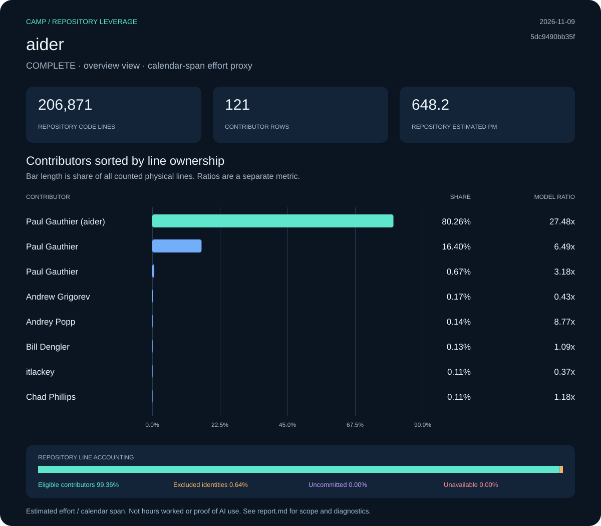

# aider: Camp leverage report

**Status:** complete · **Snapshot:** 2026-11-09T21:01:24.493519Z · **Revision:** `5dc9490bb35f9729ef2c95d00a19ccd30c26339c`

| Measurement | Result |
| :--- | ---: |
| Files | 510 |
| Code lines | 206,871 |
| Physical lines | 245,334 |
| Repository estimated effort (PM) | 648.18 |
| Repository ratio | 36.24x |
| Selected effort proxy (PM) | 17.88 |
| Effort basis | repository_blame_weighted_v1 |

## Contributors

Sort: ownership. Showing up to 10 of 121 collected rows.

| Contributor | Physical lines | Share | Est. PM | Span PM | Ratio |
| :--- | ---: | ---: | ---: | ---: | ---: |
| Paul Gauthier (aider) | 196,904 | 80.26% | 520.23 | 18.93 | 27.48x |
| Paul Gauthier | 40,245 | 16.40% | 106.33 | 16.39 | 6.49x |
| Paul Gauthier | 1,652 | 0.67% | 4.36 | 1.37 | 3.18x |
| Andrew Grigorev | 429 | 0.17% | 1.13 | 2.62 | 0.43x |
| Andrey Popp | 332 | 0.14% | 0.88 | 0.10 | 8.77x |
| Bill Dengler | 309 | 0.13% | 0.82 | 0.75 | 1.09x |
| itlackey | 278 | 0.11% | 0.73 | 2.00 | 0.37x |
| Chad Phillips | 258 | 0.11% | 0.68 | 0.58 | 1.18x |
| deansher | 201 | 0.08% | 0.53 | 0.10 | 5.31x |
| lentil32 (aider) | 184 | 0.07% | 0.49 | 0.10 | 4.86x |

[Contributor CSV](data/contributors.csv) · [Snapshot metadata](data/snapshot.json)

## Line accounting

| Bucket | Physical lines | Share | Estimated PM |
| :--- | ---: | ---: | ---: |
| Eligible contributors | 243,775 | 99.36% | 644.06 |
| Excluded identities | 1,559 | 0.64% | 4.12 |
| Uncommitted | 0 | 0.00% | 0.00 |
| Unavailable | 0 | 0.00% | 0.00 |

## Method and diagnostics

PM means person-months. COCOMO effort is allocated by surviving physical-line ownership. Contributor ratios divide that allocation by repository-wide local-ref commit spans, floored at 0.1 months. Exclusions limit current source ownership, not the historical span. Repository summary and manual team-size views have their own recorded effort basis; contributor ratios must not be added.

Calendar span is not a timesheet. A result covers one repository, not a person’s total work or proof of AI use. Uncommitted, excluded and unavailable shares are kept separate. Null ratios are unavailable, not zero.

Diagnostic codes: none.

Raw exports, when present under `raw/`, include original identities and local paths. Portable data omits email IDs and local paths; display names are retained. Nothing was published.
