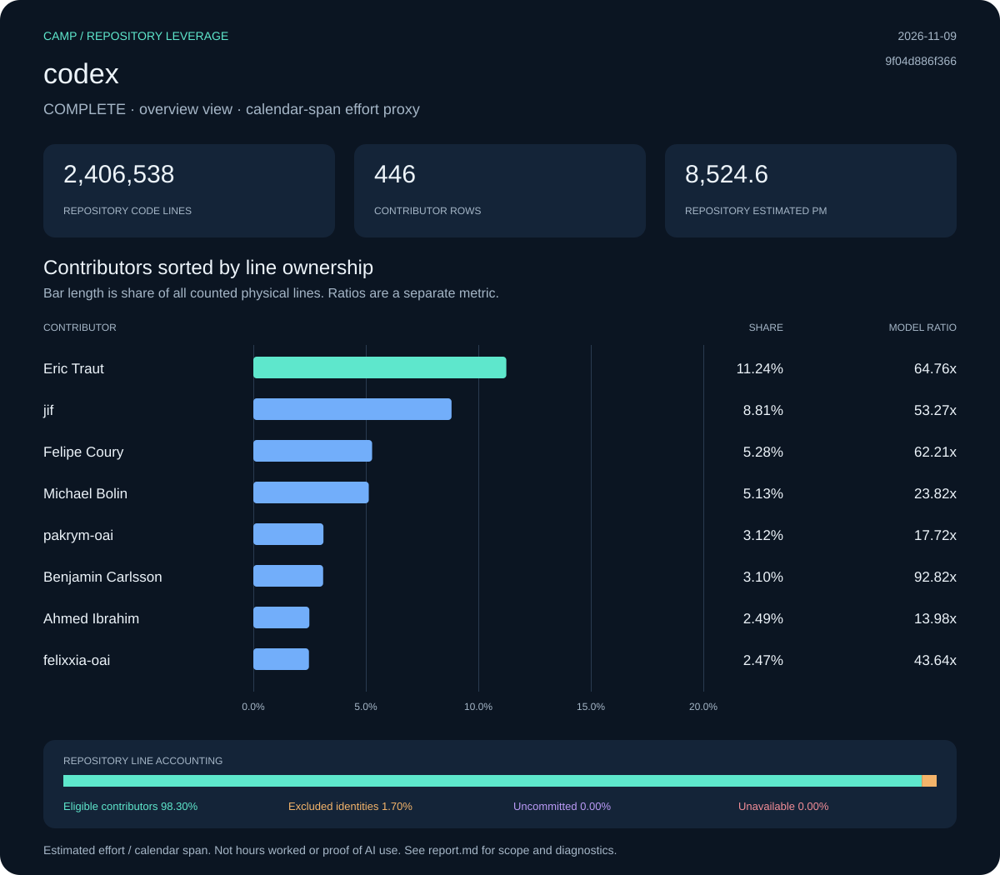

# codex: Camp leverage report

**Status:** complete · **Snapshot:** 2026-11-09T21:03:45.067247Z · **Revision:** `9f04d886f3663b584fba87d6fd71001fb6f9fcf3`

| Measurement | Result |
| :--- | ---: |
| Files | 8,267 |
| Code lines | 2,406,538 |
| Physical lines | 2,635,540 |
| Repository estimated effort (PM) | 8,524.59 |
| Repository ratio | 1,104.41x |
| Selected effort proxy (PM) | 7.72 |
| Effort basis | repository_blame_weighted_v1 |

## Contributors

Sort: ownership. Showing up to 10 of 446 collected rows.

| Contributor | Physical lines | Share | Est. PM | Span PM | Ratio |
| :--- | ---: | ---: | ---: | ---: | ---: |
| Eric Traut | 296,342 | 11.24% | 958.51 | 14.80 | 64.76x |
| jif | 232,180 | 8.81% | 750.98 | 14.10 | 53.27x |
| Felipe Coury | 139,136 | 5.28% | 450.03 | 7.23 | 62.21x |
| Michael Bolin | 135,227 | 5.13% | 437.39 | 18.36 | 23.82x |
| pakrym-oai | 82,118 | 3.12% | 265.61 | 14.99 | 17.72x |
| Benjamin Carlsson | 81,773 | 3.10% | 264.49 | 2.85 | 92.82x |
| Ahmed Ibrahim | 65,624 | 2.49% | 212.26 | 15.18 | 13.98x |
| felixxia-oai | 65,147 | 2.47% | 210.72 | 4.83 | 43.64x |
| viyatb-oai | 59,961 | 2.28% | 193.94 | 11.76 | 16.49x |
| Contributor da935f78 | 56,321 | 2.14% | 182.17 | 5.56 | 32.78x |

[Contributor CSV](data/contributors.csv) · [Snapshot metadata](data/snapshot.json)

## Line accounting

| Bucket | Physical lines | Share | Estimated PM |
| :--- | ---: | ---: | ---: |
| Eligible contributors | 2,590,813 | 98.30% | 8,379.92 |
| Excluded identities | 44,727 | 1.70% | 144.67 |
| Uncommitted | 0 | 0.00% | 0.00 |
| Unavailable | 0 | 0.00% | 0.00 |

## Method and diagnostics

PM means person-months. COCOMO effort is allocated by surviving physical-line ownership. Contributor ratios divide that allocation by repository-wide local-ref commit spans, floored at 0.1 months. Exclusions limit current source ownership, not the historical span. Repository summary and manual team-size views have their own recorded effort basis; contributor ratios must not be added.

Calendar span is not a timesheet. A result covers one repository, not a person’s total work or proof of AI use. Uncommitted, excluded and unavailable shares are kept separate. Null ratios are unavailable, not zero.

Diagnostic codes: none.

Raw exports, when present under `raw/`, include original identities and local paths. Portable data omits email IDs and local paths; display names are retained. Nothing was published.
