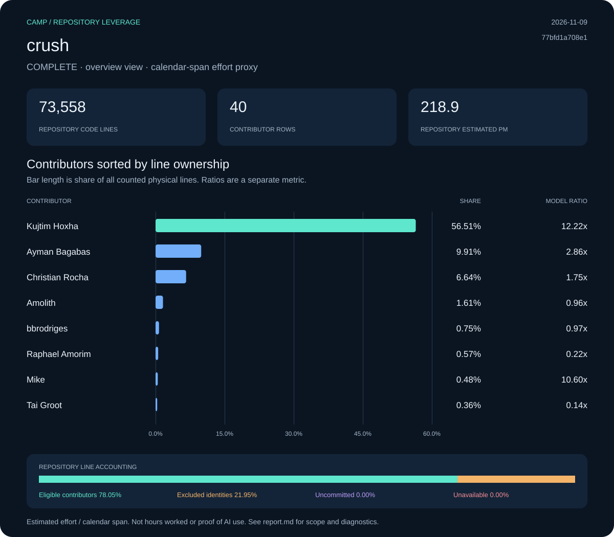

# crush: Camp leverage report

**Status:** complete · **Snapshot:** 2026-11-09T05:39:13.476706Z · **Revision:** `77bfd1a708e19b58d3c6525c46dd0c2c3add3cf7`

| Measurement | Result |
| :--- | ---: |
| Files | 429 |
| Code lines | 73,558 |
| Physical lines | 91,697 |
| Repository estimated effort (PM) | 218.86 |
| Repository ratio | 30.92x |
| Selected effort proxy (PM) | 7.08 |
| Effort basis | repository_blame_weighted_v1 |

## Contributors

Sort: ownership. Showing up to 10 of 40 collected rows.

| Contributor | Physical lines | Share | Est. PM | Span PM | Ratio |
| :--- | ---: | ---: | ---: | ---: | ---: |
| Kujtim Hoxha | 51,816 | 56.51% | 123.67 | 10.12 | 12.22x |
| Ayman Bagabas | 9,088 | 9.91% | 21.69 | 7.57 | 2.86x |
| Christian Rocha | 6,086 | 6.64% | 14.53 | 8.32 | 1.75x |
| Amolith | 1,480 | 1.61% | 3.53 | 3.67 | 0.96x |
| bbrodriges | 688 | 0.75% | 1.64 | 1.69 | 0.97x |
| Raphael Amorim | 523 | 0.57% | 1.25 | 5.59 | 0.22x |
| Mike | 444 | 0.48% | 1.06 | 0.10 | 10.60x |
| Tai Groot | 328 | 0.36% | 0.78 | 5.47 | 0.14x |
| Jon Gjengset | 224 | 0.24% | 0.53 | 0.10 | 5.35x |
| Kieran Klukas | 126 | 0.14% | 0.30 | 4.75 | 0.06x |

[Contributor CSV](data/contributors.csv) · [Snapshot metadata](data/snapshot.json)

## Line accounting

| Bucket | Physical lines | Share | Estimated PM |
| :--- | ---: | ---: | ---: |
| Eligible contributors | 71,568 | 78.05% | 170.82 |
| Excluded identities | 20,129 | 21.95% | 48.04 |
| Uncommitted | 0 | 0.00% | 0.00 |
| Unavailable | 0 | 0.00% | 0.00 |

## Method and diagnostics

PM means person-months. COCOMO effort is allocated by surviving physical-line ownership. Contributor ratios divide that allocation by repository-wide local-ref commit spans, floored at 0.1 months. Exclusions limit current source ownership, not the historical span. Repository summary and manual team-size views have their own recorded effort basis; contributor ratios must not be added.

Calendar span is not a timesheet. A result covers one repository, not a person’s total work or proof of AI use. Uncommitted, excluded and unavailable shares are kept separate. Null ratios are unavailable, not zero.

Diagnostic codes: none.

Raw exports, when present under `raw/`, include original identities and local paths. Portable data omits email IDs and local paths; display names are retained. Nothing was published.
