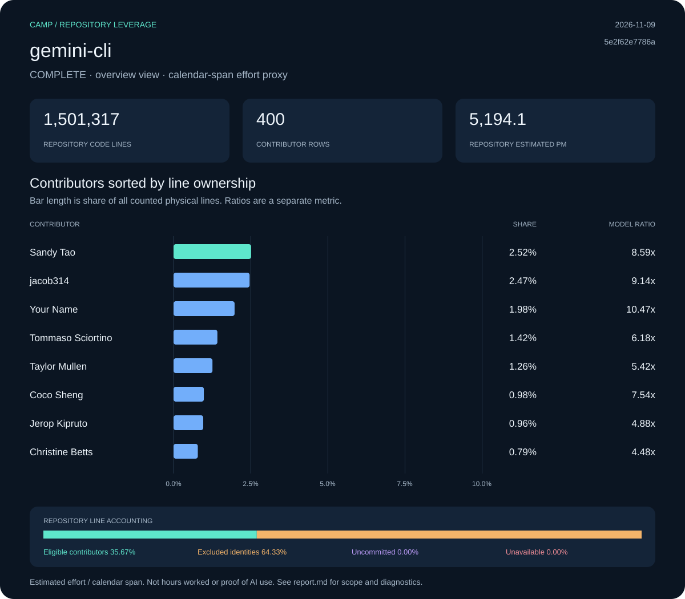

# gemini-cli: Camp leverage report

**Status:** complete · **Snapshot:** 2026-11-09T21:01:37.621538Z · **Revision:** `5e2f62e7786a7c670f5a5e21ab653ebcd45b7a7d`

| Measurement | Result |
| :--- | ---: |
| Files | 2,789 |
| Code lines | 1,501,317 |
| Physical lines | 1,643,738 |
| Repository estimated effort (PM) | 5,194.06 |
| Repository ratio | 4,167.27x |
| Selected effort proxy (PM) | 1.25 |
| Effort basis | repository_blame_weighted_v1 |

## Contributors

Sort: ownership. Showing up to 10 of 400 collected rows.

| Contributor | Physical lines | Share | Est. PM | Span PM | Ratio |
| :--- | ---: | ---: | ---: | ---: | ---: |
| Sandy Tao | 41,362 | 2.52% | 130.70 | 15.22 | 8.59x |
| jacob314 | 40,564 | 2.47% | 128.18 | 14.02 | 9.14x |
| Your Name | 32,557 | 1.98% | 102.88 | 9.82 | 10.47x |
| Tommaso Sciortino | 23,387 | 1.42% | 73.90 | 11.95 | 6.18x |
| Taylor Mullen | 20,754 | 1.26% | 65.58 | 12.10 | 5.42x |
| Coco Sheng | 16,154 | 0.98% | 51.05 | 6.77 | 7.54x |
| Jerop Kipruto | 15,838 | 0.96% | 50.05 | 10.25 | 4.88x |
| Christine Betts | 12,949 | 0.79% | 40.92 | 9.13 | 4.48x |
| Sehoon Shon | 12,936 | 0.79% | 40.88 | 5.73 | 7.14x |
| jvargassanchez-dot | 12,831 | 0.78% | 40.54 | 5.62 | 7.21x |

[Contributor CSV](data/contributors.csv) · [Snapshot metadata](data/snapshot.json)

## Line accounting

| Bucket | Physical lines | Share | Estimated PM |
| :--- | ---: | ---: | ---: |
| Eligible contributors | 586,324 | 35.67% | 1,852.73 |
| Excluded identities | 1,057,414 | 64.33% | 3,341.33 |
| Uncommitted | 0 | 0.00% | 0.00 |
| Unavailable | 0 | 0.00% | 0.00 |

## Method and diagnostics

PM means person-months. COCOMO effort is allocated by surviving physical-line ownership. Contributor ratios divide that allocation by repository-wide local-ref commit spans, floored at 0.1 months. Exclusions limit current source ownership, not the historical span. Repository summary and manual team-size views have their own recorded effort basis; contributor ratios must not be added.

Calendar span is not a timesheet. A result covers one repository, not a person’s total work or proof of AI use. Uncommitted, excluded and unavailable shares are kept separate. Null ratios are unavailable, not zero.

Diagnostic codes: none.

Raw exports, when present under `raw/`, include original identities and local paths. Portable data omits email IDs and local paths; display names are retained. Nothing was published.
