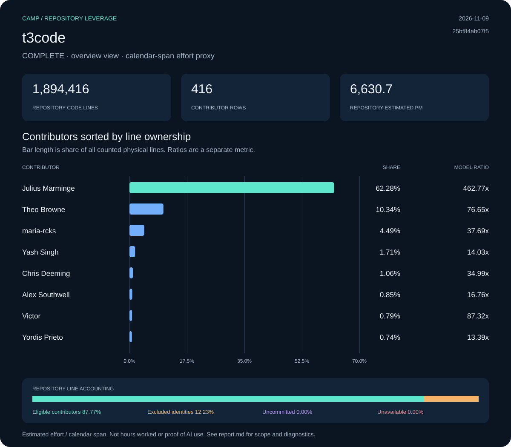

# t3code: Camp leverage report

**Status:** complete · **Snapshot:** 2026-11-09T00:33:14.458864Z · **Revision:** `25bf84ab07f53f141c20239c63e383823a9d5ea0`

| Measurement | Result |
| :--- | ---: |
| Files | 7,198 |
| Code lines | 1,894,416 |
| Physical lines | 2,101,875 |
| Repository estimated effort (PM) | 6,630.72 |
| Repository ratio | 947.64x |
| Selected effort proxy (PM) | 7.00 |
| Effort basis | repository_blame_weighted_v1 |

## Contributors

Sort: ownership. Showing up to 10 of 416 collected rows.

| Contributor | Physical lines | Share | Est. PM | Span PM | Ratio |
| :--- | ---: | ---: | ---: | ---: | ---: |
| Julius Marminge | 1,309,143 | 62.28% | 4,129.91 | 8.92 | 462.77x |
| Theo Browne | 217,255 | 10.34% | 685.37 | 8.94 | 76.65x |
| maria-rcks | 94,359 | 4.49% | 297.67 | 7.90 | 37.69x |
| Yash Singh | 35,992 | 1.71% | 113.54 | 8.09 | 14.03x |
| Chris Deeming | 22,283 | 1.06% | 70.30 | 2.01 | 34.99x |
| Alex Southwell | 17,869 | 0.85% | 56.37 | 3.36 | 16.76x |
| Victor | 16,634 | 0.79% | 52.47 | 0.60 | 87.32x |
| Yordis Prieto | 15,622 | 0.74% | 49.28 | 3.68 | 13.39x |
| Alex | 13,601 | 0.65% | 42.91 | 3.63 | 11.83x |
| Tristan Knight | 5,093 | 0.24% | 16.07 | 2.88 | 5.58x |

[Contributor CSV](data/contributors.csv) · [Snapshot metadata](data/snapshot.json)

## Line accounting

| Bucket | Physical lines | Share | Estimated PM |
| :--- | ---: | ---: | ---: |
| Eligible contributors | 1,844,714 | 87.77% | 5,819.46 |
| Excluded identities | 257,161 | 12.23% | 811.26 |
| Uncommitted | 0 | 0.00% | 0.00 |
| Unavailable | 0 | 0.00% | 0.00 |

## Method and diagnostics

PM means person-months. COCOMO effort is allocated by surviving physical-line ownership. Contributor ratios divide that allocation by repository-wide local-ref commit spans, floored at 0.1 months. Exclusions limit current source ownership, not the historical span. Repository summary and manual team-size views have their own recorded effort basis; contributor ratios must not be added.

Calendar span is not a timesheet. A result covers one repository, not a person’s total work or proof of AI use. Uncommitted, excluded and unavailable shares are kept separate. Null ratios are unavailable, not zero.

Diagnostic codes: none.

Raw exports, when present under `raw/`, include original identities and local paths. Portable data omits email IDs and local paths; display names are retained. Nothing was published.
